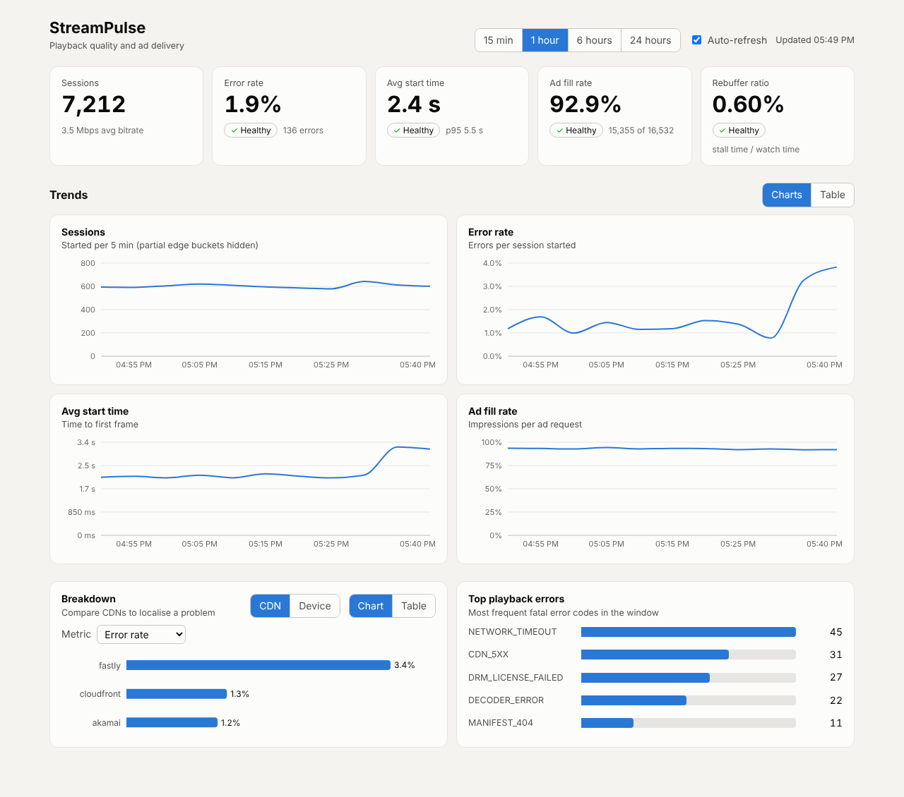
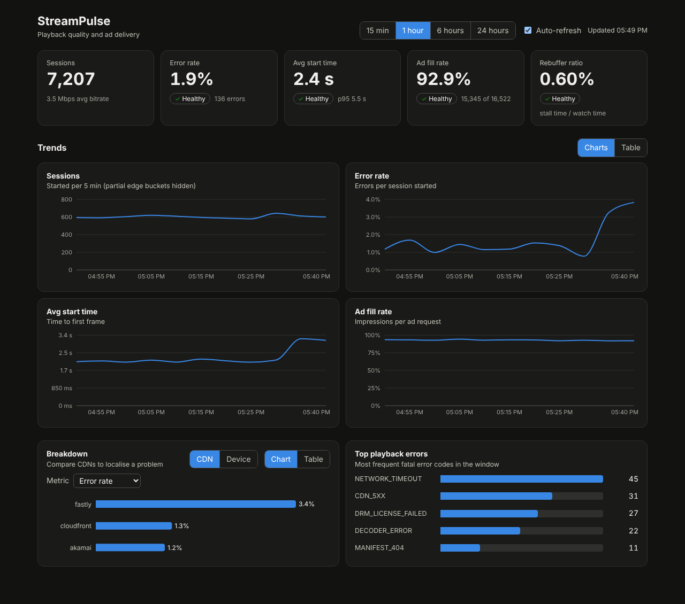
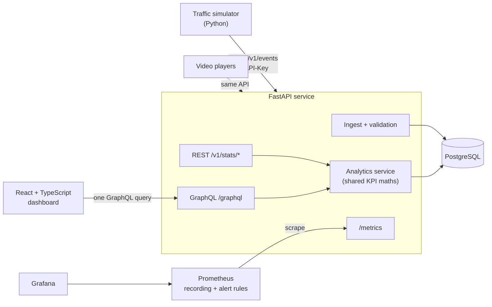

# StreamPulse

Playback quality and ad-delivery analytics for a video streaming service, with the observability and
cloud tooling around it. Video players send telemetry; StreamPulse ingests it, turns it into the metrics a
streaming team watches (start time, error rate, rebuffering, ad fill), exposes them through REST and
GraphQL, and instruments itself with Prometheus and Grafana.



<details>
<summary>Dark mode</summary>



</details>

## Architecture



| Piece | Tech |
|---|---|
| API | Python 3.12, FastAPI, SQLAlchemy 2, Pydantic v2, Strawberry GraphQL |
| Storage | PostgreSQL (SQLite for local dev and unit tests) |
| Dashboard | React 19, TypeScript, Vite, Recharts, Vitest |
| Observability | Prometheus (recording + alert rules), Grafana (provisioned dashboard) |
| Packaging | Docker, Docker Compose |
| CI | GitHub Actions |
| Cloud | Terraform: ECS Fargate + ALB + RDS + S3/CloudFront + Secrets Manager |

## Run it

**Everything in Docker** (API, Postgres, simulator, dashboard, Prometheus, Grafana):

```bash
docker compose up --build
```

| What | URL |
|---|---|
| Dashboard | http://localhost:8080 |
| API docs (OpenAPI) | http://localhost:8000/docs |
| Prometheus (rules and alerts) | http://localhost:9090 |
| Grafana (admin / admin) | http://localhost:3001 |

The simulator loads 30 minutes of history, then streams live traffic. After three minutes it degrades
the `fastly` CDN: error rate and start time climb, the dashboard banner turns on, and the
`CdnPlaybackErrorRateHigh` alert goes pending, then fires in Prometheus a few minutes later.

**Without Docker** (SQLite):

```bash
make install        # venv + npm ci
make api            # terminal 1: API on :8000
make simulate       # terminal 2: history, then live traffic with a CDN incident
make web            # terminal 3: dashboard on :5173
make test lint      # backend (pytest, ruff) and frontend (vitest, tsc)
```

## What it does

**Ingest** `POST /v1/events` accepts batches of player events. Validation is strict: required fields depend
on the event type (a `playback_start` needs `value_ms`, an error needs `error_code`), one bad event rejects
the batch, batches are capped, and an optional `X-API-Key` protects the endpoint. Timestamps are normalised to UTC.

**Analytics** (REST under `/v1/stats/*`, and the same data over GraphQL):

| KPI | Definition |
|---|---|
| Error rate | fatal playback errors / sessions started |
| Avg and p95 start time | mean and nearest-rank p95 of `playback_start` durations |
| Ad fill rate | ad impressions / ad requests |
| Rebuffer ratio | total stall time / total watch time |

Endpoints: summary, zero-filled time series, breakdown by device / CDN / content type, top error codes,
and a per-session event timeline. REST and GraphQL call the same service functions, so they cannot disagree
(a test asserts that).

**Dashboard** is a single GraphQL query per refresh. Every status shows an icon and a word, not just
colour. Every chart has a table view, and the first and last (partial) time buckets are hidden so the right
edge doesn't look like an outage.

## Observability

- The API exports business metrics (`streampulse_playback_startup_seconds` histogram, error and ad
  counters, ingest rate) and HTTP metrics labelled by **route template**, not raw path.
- Client-controlled label values (CDN, error code) go through a cardinality guard so a misbehaving client
  cannot create unbounded time series.
- `observability/prometheus/rules.yml` has recording rules and nine alerts. Their thresholds mirror the
  status colours in the dashboard.
- The Grafana dashboard is provisioned from JSON, so it is reviewed in pull requests like any other code.

## Deploy to AWS

`infra/terraform` builds: a CloudFront distribution (S3 for the static dashboard, the load balancer for
`/graphql` and `/v1/*`), an ALB that only accepts traffic from CloudFront, an ECS Fargate service with
autoscaling and a deployment circuit breaker, RDS PostgreSQL (encrypted, not public), and Secrets Manager
for the database URL and ingest key.

```bash
cd infra/terraform
cp terraform.tfvars.example terraform.tfvars          # set api_image_tag to a git SHA
terraform init
terraform apply -target=aws_ecr_repository.api        # 1. create the registry first

TAG=$(git rev-parse --short HEAD)
REPO=$(terraform output -raw ecr_repository_url)
aws ecr get-login-password | docker login --username AWS --password-stdin "${REPO%%/*}"
docker buildx build --platform linux/amd64 -t "$REPO:$TAG" --push ../../backend   # 2. push the image

terraform apply -var "api_image_tag=$TAG"             # 3. everything else
(cd ../../frontend && npm ci && npm run build)
aws s3 sync ../../frontend/dist "s3://$(terraform output -raw web_bucket)" --delete
aws cloudfront create-invalidation --distribution-id "$(terraform output -raw cloudfront_distribution_id)" --paths "/*"
terraform output url
```

Expect roughly $60-80/month while it runs (ALB, RDS, two Fargate tasks). Run `terraform destroy` when done.

## CI

`.github/workflows/ci.yml` runs on every push and pull request:

- **backend** on a matrix of SQLite and a real PostgreSQL service: `ruff`, `pytest`, 90% coverage gate
- **frontend**: type check, tests, production build
- **observability**: `promtool check config` (validates the rule files) and dashboard JSON
- **docker**: builds both images and validates the compose file
- **terraform**: `fmt -check`, `init -backend=false`, `validate`

## Design decisions

- **One analytics service, two APIs.** KPI maths lives in `app/services/analytics.py`; REST and GraphQL are thin
  adapters. KPIs are computed from per-type rollups, so summary, time series and breakdown share one function.
- **Portable SQL.** Events store a minute-truncated timestamp, so bucketing is a plain `GROUP BY` that behaves the
  same on SQLite and PostgreSQL. p95 uses `ORDER BY ... LIMIT 1 OFFSET n` instead of a vendor percentile function.
- **Blocking DB work stays off the event loop.** REST handlers are sync (FastAPI runs them in a thread pool);
  GraphQL resolvers hand their queries to the thread pool explicitly.
- **Testability by injection.** The app factory takes a clock, so time-window tests use a frozen "now".
- **One measure per chart.** Different scales get separate charts instead of a dual axis.

## Known limitations and next steps

- Schema is created with `create_all`; a real deployment should use Alembic migrations.
- Event queries scan the raw table. At real volume, add time partitioning and pre-aggregated rollup tables
  (or a columnar store), and put a queue such as Kafka in front of ingestion.
- The dashboard's read endpoints are unauthenticated; only ingest has an API key.
- CloudFront talks to the ALB over HTTP inside AWS. Production should add a custom domain and ACM certificate.
- Prometheus and Grafana run in Docker Compose only; on AWS you would use Amazon Managed Prometheus/Grafana.
- No Alertmanager is wired up, so alerts are visible in Prometheus but not routed anywhere.

## Layout

```
backend/        FastAPI app, tests (pytest), traffic simulator, Dockerfile
frontend/       React + TypeScript dashboard, tests (Vitest), Dockerfile + nginx
observability/  Prometheus config and rules, Grafana provisioning and dashboard
infra/          Terraform for AWS
.github/        CI workflow
```
